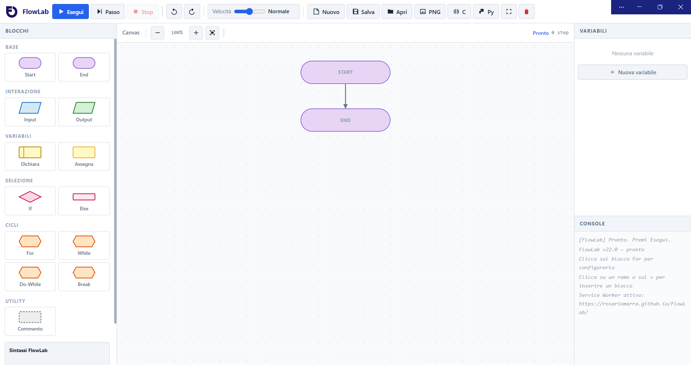
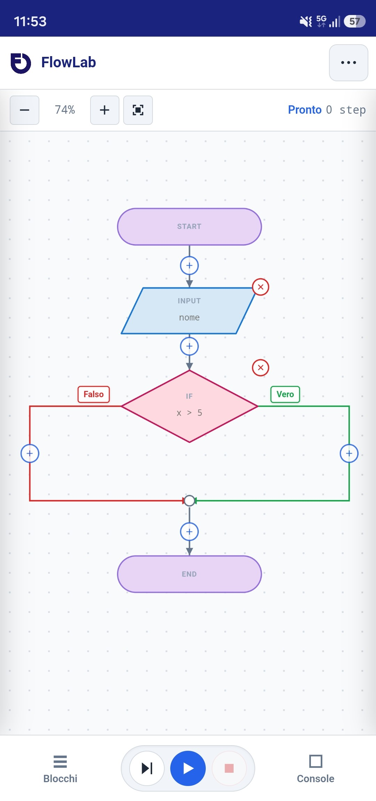

<div align="center">


# FlowLab

**Editor visuale di flowchart con la sintassi di Flowgorithm: esecuzione passo-passo, funzioni, array, grafici e generazione di codice in 7 linguaggi.**

Un ambiente di programmazione visuale ispirato a Flowgorithm, completamente riscritto in tecnologie web moderne.

[](https://web.dev/progressive-web-apps/)
[](https://developer.mozilla.org/en-US/docs/Web/JavaScript)
[](#)
[](#)

</div>

---

## Indice

- [Cos'è FlowLab](#cosè-flowlab)
- [Funzionalità](#funzionalità)
- [Screenshot](#screenshot)
- [Demo](#demo)
- [Installazione](#installazione)
- [Come si usa](#come-si-usa)
- [Sintassi del linguaggio](#sintassi-del-linguaggio)
- [Formato file `.fl`](#formato-file-fl)
- [Struttura del progetto](#struttura-del-progetto)
- [Architettura tecnica](#architettura-tecnica)
- [Compatibilità](#compatibilità)
- [Roadmap](#roadmap)
- [Contribuire](#contribuire)
- [Credits](#credits)

---

## Cos'è FlowLab

**FlowLab** è un'applicazione web progressiva (PWA) che permette di creare, modificare ed eseguire **diagrammi di flusso** direttamente dal browser, senza installare nulla.

È pensato per:

- **Studenti** che imparano i fondamenti della programmazione (variabili, cicli, condizioni, funzioni)
- **Insegnanti** che vogliono uno strumento semplice per spiegare gli algoritmi
- **Chiunque** voglia visualizzare la logica di un programma prima di scriverlo in codice

A differenza di Flowgorithm (Windows-only), FlowLab funziona ovunque: **desktop, tablet e smartphone**, anche **senza connessione internet** dopo il primo caricamento.

---

## Funzionalità

### Editor visuale
- **Layout automatico** in stile Flowgorithm con collegamenti ortogonali, rami Vero/Falso colorati e cerchi di unione
- **Pulsanti `+`** su ogni collegamento per inserire blocchi nel punto esatto
- **Trascinamento**: trascina un blocco (con tutto il suo contenuto) su un `+` per spostarlo; trascina un blocco dalla palette direttamente nel diagramma
- **Copia / incolla / duplica** (Ctrl+C, Ctrl+V, Ctrl+D) e menu contestuale con il tasto destro
- **Validazione in tempo reale**: le espressioni con errori di sintassi vengono sottolineate prima dell'esecuzione
- **Zoom** con rotellina, pulsanti o pinch; **pan** con trascinamento sul vuoto
- **Tema chiaro e scuro** (segue il sistema, commutabile)

### Sintassi identica a Flowgorithm
- Operatori `=`/`==`, `<>`/`!=`, `and`/`&&`, `or`/`||`, `not`/`!`, `mod`/`%`, `^` (potenza), `&` (concatenazione)
- Stessa precedenza degli operatori, parole chiave non sensibili alle maiuscole
- Funzioni intrinseche di Flowgorithm: `Abs`, `Arccos`, `Arcsin`, `Arctan`, `Char`, `Cos`, `Int`, `Len`, `Log`, `Log10`, `Mid`, `Pi`, `Random`, `Sgn`, `Sin`, `Size`, `Sqrt`, `Tan`, `ToChar`, `ToCode`, `ToFixed`, `ToInteger`, `ToReal`, `ToString`
- Variabili da **dichiarare** con il blocco Declare, controlli di tipo, errore se si legge una variabile senza valore
- **Array** (`voti[10]`, indici da 0, `Size(v)`), passati per riferimento alle funzioni
- **Funzioni definite dall'utente** con parametri, tipo restituito, variabile di ritorno e **ricorsione**
- **Import / export `.fprg`**: apri i file di Flowgorithm e riesporta i tuoi progetti per Flowgorithm

### Blocchi
`Declare` · `Assign` · `Input` · `Output` (con opzione “a capo”) · `If` · `While` · `For` · `Do` · `Call` · `Commento` · `Break` (estensione)

### Esecuzione e debug
- **Esegui / Pausa / Continua**, **Passo** (F10) che segue davvero il flusso del programma, **Stop**
- **6 velocità**, da Lenta a **Istantanea** (fino a milioni di passi)
- **Breakpoint** sui blocchi (F9): l'esecuzione si ferma e puoi proseguire passo-passo
- **Pannello Variabili** con lo **stack delle chiamate** (vedi ogni livello della ricorsione) e il contenuto degli array
- **Mappa di calore**: mostra quante volte è stato eseguito ogni blocco
- **Errori chiari** in italiano, con il blocco colpevole evidenziato
- Input direttamente nella console, con validazione del tipo

### Grafici e disegno
- **Andamento delle variabili** numeriche nel tempo (grafico a linee, serie attivabili)
- **Array come barre animate** in tempo reale (perfetto per gli algoritmi di ordinamento)
- **Plot**: `Plot(x, y)`, `PlotBar(etichetta, valore)` per disegnare grafici di funzioni e istogrammi
- **Canvas di disegno 400×400**: `DrawLine`, `DrawRect`, `FillRect`, `DrawCircle`, `FillCircle`, `DrawText`, `SetColor`…
- **Grafica a tartaruga**: `Forward`, `Back`, `TurnLeft`, `TurnRight`, `PenUp`, `PenDown`, `Home`
- Esportazione del disegno in PNG

### Generazione di codice
**Python**, **C**, **C++**, **Java**, **C#**, **JavaScript** e **pseudocodice** in italiano, con indentazione corretta, funzioni, array, cicli Do e conversioni di tipo. Evidenziazione della sintassi, copia e download.

### File, PWA e mobile
- Salvataggio diretto su file `.fl` (File System Access API) e salvataggio automatico locale
- Conversione automatica dei progetti delle versioni precedenti
- Esportazione del diagramma in **PNG**
- **15 esempi pronti** (base, intermedi, avanzati e grafici)
- PWA installabile e **offline**, interfaccia completa anche su smartphone

---

## Screenshot


| Desktop | Mobile |
|---|---|
|  |  |

---

## Demo

> **Demo live**: [https://rosariomarra.github.io/FlowLab/](https://rosariomarra.github.io/FlowLab/)


---

## Installazione

### Opzione 1 — Usa l'app online

Apri il link della [demo live](#demo). Non serve installare nulla.

### Opzione 2 — Installa come PWA

1. Apri FlowLab nel browser
2. Clicca l'icona **Installa** nella barra degli indirizzi (Chrome/Edge)
3. Su **iOS Safari**: `Condividi` → `Aggiungi a Home`
4. Su **Android Chrome**: menu `⋮` → `Installa app`

L'app verrà aggiunta alla home come un'app nativa.

### Opzione 3 — Sviluppo locale

```bash
# 1. Clona il repository
git clone https://github.com/rosariomarra/FlowLab.git
cd FlowLab

# 2. Avvia un server locale
# Con Python:
python3 -m http.server 8000

# Con Node.js:
npx serve

# Con VS Code: estensione "Live Server"

# 3. Apri il browser
# http://localhost:8000
```

> Il Service Worker richiede **HTTPS** o **localhost**. Non funziona aprendo `index.html` direttamente con doppio click.

---

## Come si usa

1. All'avvio trovi un esempio pronto: premi **▶ Esegui**
2. Clicca su un **`+`** del diagramma (o su un blocco della palette) per aggiungere blocchi
3. Scrivi il contenuto direttamente nel blocco, con la sintassi di Flowgorithm
4. Usa **Passo** per eseguire un blocco alla volta e osserva le **Variabili**
5. Crea nuove **funzioni** con il pulsante `+` accanto alla scheda **Main**
6. **Codice** genera il programma in 7 linguaggi, **Esporta** produce PNG o `.fprg`

### Scorciatoie

| Tasti | Azione |
|---|---|
| `Ctrl+Invio` | Esegui / pausa / continua |
| `F10` | Passo successivo |
| `F9` | Breakpoint sul blocco selezionato |
| `Canc` | Elimina il blocco selezionato |
| `Ctrl+C` / `Ctrl+V` / `Ctrl+D` | Copia / incolla / duplica |
| `Ctrl+Z` / `Ctrl+Y` | Annulla / ripeti |
| `Ctrl+S` / `Ctrl+O` / `Ctrl+N` | Salva / apri / nuovo |
| `F1` | Guida alla sintassi |
| `Esc` | Chiudi finestre / ferma l'esecuzione |

---

## Sintassi del linguaggio

FlowLab usa **la stessa sintassi di Flowgorithm**.

### Tipi di dato

| Tipo | Esempio |
|---|---|
| `Integer` | `42`, `-7` |
| `Real` | `3.14` |
| `String` | `"ciao"` |
| `Boolean` | `true`, `false` |
| `Character` | `'A'` (estensione FlowLab) |

### Blocchi

```
Declare   Integer a, b, voti[10]
Assign    media = (a + b) / 2
Input     nome
Output    "Ciao " & nome & ", hai " & eta & " anni"
If        x > 0 and x <> 5
While     i < 10
For       i = 1 to 10 step 2        (crescente o decrescente)
Do        risposta <> 0             (il corpo viene eseguito almeno una volta)
Call      Stampa(v)
```

### Operatori

| Categoria | Operatori |
|---|---|
| Aritmetici | `+` `-` `*` `/` `%` o `mod` `^` |
| Confronto | `=` o `==`, `<>` o `!=`, `<` `<=` `>` `>=` |
| Logici | `and` o `&&`, `or` o `||`, `not` o `!` |
| Stringhe | `&` concatena qualsiasi valore |

Precedenza (dalla più alta): unari → `^` → `* / mod` → `+ -` → `&` → confronti → `and` → `or`.

### Funzioni intrinseche

| Categoria | Funzioni |
|---|---|
| Matematiche | `Abs` `Sqrt` `Int` `Sgn` `Log` `Log10` `Sin` `Cos` `Tan` `Arcsin` `Arccos` `Arctan` `Random(n)` `Pi` |
| Stringhe | `Len(s)` `Char(s, i)` `Mid(s, inizio, quanti)` |
| Conversioni | `ToInteger` `ToReal` `ToString` `ToChar` `ToCode` `ToFixed(x, cifre)` |
| Array | `Size(v)` |
| Estensioni | `Min` `Max` `Pow` `Round` `Floor` `Ceil` `Exp` `ToUpper` `ToLower` `Trim` `IsNumber` |

### Grafica (blocco Call)

| Categoria | Procedure |
|---|---|
| Grafici | `Plot(x, y)` `PlotBar(etichetta, valore)` `ClearPlot()` |
| Disegno | `ClearCanvas()` `SetColor(c)` `SetFill(c)` `SetLineWidth(n)` `DrawLine` `DrawRect` `FillRect` `DrawCircle` `FillCircle` `DrawText` `DrawPoint` |
| Tartaruga | `Forward(n)` `Back(n)` `TurnRight(g)` `TurnLeft(g)` `PenUp()` `PenDown()` `Home()` `SetPosition(x, y)` `SetHeading(g)` |
| Tempo | `Wait(ms)` |

### Funzioni

Ogni funzione ha la propria scheda. Si definiscono nome, parametri (con tipo e flag array), tipo restituito e variabile di ritorno, come in Flowgorithm:

```
Funzione Fattoriale(Integer n) : Integer   → variabile di ritorno: risultato
  Declare Integer risultato
  If n <= 1
    risultato = 1
  Else
    risultato = n * Fattoriale(n - 1)
```

---

## Formato file `.fl`

I progetti sono salvati in JSON:

```json
{
  "app": "FlowLab",
  "format": "flowlab",
  "version": "25.0",
  "name": "Fattoriale",
  "funcs": [
    {
      "name": "Main", "params": [], "returnType": "None", "returnVar": "",
      "nodes": [
        { "id": "a1", "type": "start", "text": "" },
        { "id": "a2", "type": "declare", "declareType": "Integer", "text": "n" },
        { "id": "a3", "type": "output", "text": "n & \"! = \" & Fattoriale(n)", "newline": true },
        { "id": "a4", "type": "end", "text": "" }
      ]
    }
  ]
}
```

I file della versione 24 (con `nodes` e `varDefs`) vengono convertiti automaticamente. FlowLab apre e salva anche i file **`.fprg`** di Flowgorithm.

---

## Struttura del progetto

```
FlowLab/
├── index.html      # Interfaccia
├── style.css       # Stili (tema chiaro/scuro, responsive)
├── engine.js       # Lexer, parser, valutatore tipizzato, interprete
├── codegen.js      # Generatori Python, C, C++, Java, C#, JavaScript, pseudocodice
├── fprg.js         # Import/export formato Flowgorithm
├── charts.js       # Grafici, array animati, canvas di disegno e tartaruga
├── examples.js     # Libreria di esempi
├── app.js          # Editor, layout, esecuzione, file, UI
├── manifest.json   # Manifest PWA
├── sw.js           # Service Worker (offline)
└── Immagini/       # Icone e screenshot
```

## Architettura tecnica

```
Editor (blocchi)  →  lista piatta per funzione  →  parseBlock() albero strutturato
                                                    ├─ Runner (interprete asincrono: passi, breakpoint, stack)
                                                    ├─ codegen (AST → 7 linguaggi)
                                                    └─ fprg (XML Flowgorithm)
Espressioni: lex() → Parser Pratt → AST → valutazione tipizzata
```

- **Vanilla JavaScript**, nessuna dipendenza e nessuna build
- Le espressioni non vengono mai eseguite con `eval`: un parser dedicato garantisce la stessa semantica di Flowgorithm e messaggi d'errore precisi
- **SVG** per i collegamenti, **Canvas** per grafici, disegno ed export PNG

---

## Compatibilità

| Browser | Note |
|---|---|
| Chrome / Edge 90+ | Supporto completo (salvataggio diretto su file) |
| Firefox 90+ / Safari 15+ | Il salvataggio usa il download |
| Chrome Android / Safari iOS | Installabile come app |

---

## Roadmap

- [x] Sintassi e funzioni intrinseche di Flowgorithm
- [x] Array e funzioni definite dall'utente con ricorsione
- [x] Debugger con breakpoint, passo-passo e stack delle chiamate
- [x] Grafici, array animati, disegno e grafica a tartaruga
- [x] Codice in Python, C, C++, Java, C#, JavaScript e pseudocodice
- [x] Import/Export `.fprg` di Flowgorithm
- [x] Tema chiaro/scuro
- [ ] Timeline dell'esecuzione (passo indietro)
- [ ] Matrici (array bidimensionali)
- [ ] Modalità collaborativa

---

## Contribuire

I contributi sono **benvenuti**. Se vuoi migliorare FlowLab:

1. Fai un **fork** del progetto
2. Crea un **branch** per la tua feature: `git checkout -b feature/nome-feature`
3. Fai **commit** delle modifiche: `git commit -m 'Aggiunge nuova feature'`
4. Fai **push** sul branch: `git push origin feature/nome-feature`
5. Apri una **Pull Request**

### Linee guida

- Mantieni il codice **vanilla** (no framework)
- Rispetta lo stile esistente (2 spazi, commenti in italiano)
- Testa su **desktop e mobile** prima di proporre
- Aggiungi commenti chiari per funzioni complesse
- Aggiorna il README se aggiungi funzionalità

### Segnalazione bug

Apri una [issue](https://github.com/rosariomarra/FlowLab/issues) con:
- Descrizione del problema
- Passi per riprodurlo
- Screenshot (se applicabile)
- Browser e sistema operativo

---

## Credits

- **Sviluppato da** [Rosario Marra](https://github.com/rosariomarra)
- **Ispirato a** [Flowgorithm](http://www.flowgorithm.org/) di Devin Cook — il pioniere dei flowchart educativi
- **Design pattern** basati su editor visuali moderni
- **Icone SVG** progettate ad hoc per FlowLab
- **Zero dipendenze** — solo web platform APIs

---

<div align="center">

**Se ti piace FlowLab, lascia una stella su GitHub**

[Segnala un bug](https://github.com/rosariomarra/FlowLab/issues) ·
[Proponi una feature](https://github.com/rosariomarra/FlowLab/issues) ·
[Leggi la documentazione](https://github.com/rosariomarra/FlowLab/wiki)

Made with love in Italy by **Rosario Marra**

</div>
